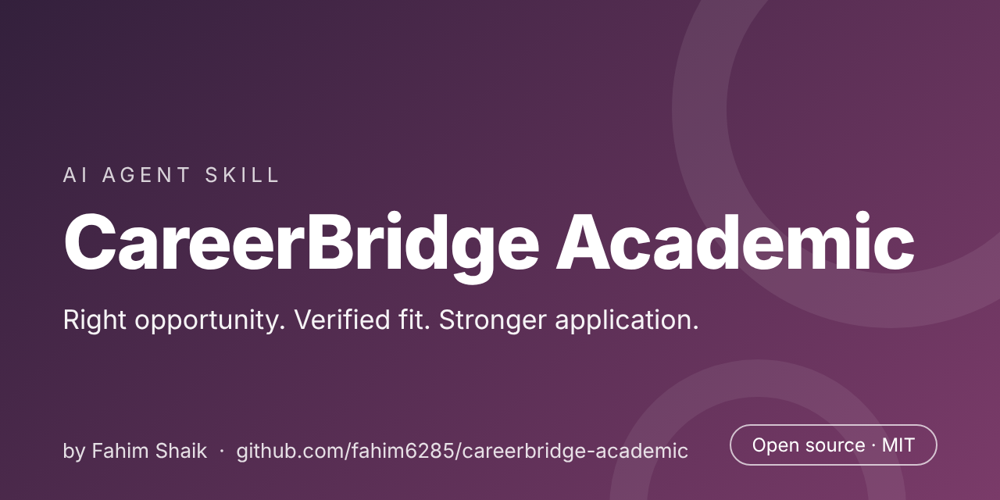

# CareerBridge Academic

**Right opportunity. Verified fit. Stronger application.**

   

Source-grounded AI agent for academic job hunting: verifies openings, checks eligibility, maps portal fields, drafts tailored applications and tracks follow-ups.



## Why use it

- **Opportunity verification.** Checks the official posting, deadline and requirements before any drafting starts.
- **Eligibility matrix.** Compares your evidence with mandatory and preferred criteria and flags gaps honestly.
- **Portal field mapping.** Maps official application-form fields and checks character limits and required fields.
- **Tailored documents.** Templates for cover letters, research and teaching statements, consulting bids and follow-up emails.
- **Tracking and audit.** Application tracker with an audit script. Drafts are never labelled as submitted.

## What is in this repository

| Part | Count | Location |
|---|---|---|
| Main skill | 1 | `skills/careerbridge-academic/SKILL.md` |
| Agent setup text | see folder | `skills/careerbridge-academic/AGENT_INSTRUCTIONS.md` |
| Reference protocols | 8 | `skills/careerbridge-academic/references/` |
| Templates | 9 | `skills/careerbridge-academic/templates/` |
| Python utilities | 1 | `skills/careerbridge-academic/scripts/` |
| Synthetic examples | 1 | `skills/careerbridge-academic/examples/` |
| Plugin manifest | 1 | `.codex-plugin/plugin.json` |

All examples are synthetic. The repository contains no private data, research results, credentials or institutional records.

## How to use it

1. **In ChatGPT or another agent builder:** create a skill or plugin from `skills/careerbridge-academic/SKILL.md` and paste `AGENT_INSTRUCTIONS.md` where the platform asks for instructions.
2. **In a regular chat:** attach `SKILL.md` and the reference files, or paste them, then describe your task.
3. **Offline tools:** run the scripts directly (see Quick start).

## Quick start

```bash
cd skills/careerbridge-academic
python scripts/audit_application.py --tracker examples/sample_application_tracker.csv
```

The audit script is a structural QA aid using only the Python standard library. It does not browse job listings, verify credential authenticity or submit applications.

## Sample prompts

- Verify this job posting and build an eligibility matrix against my CV.
- Draft a cover letter for this faculty opening using only claims I can document.
- Map this application portal's fields and tell me which ones exceed the character limits.
- Create a research statement outline tailored to this department.
- Prepare interview questions and a salary-negotiation plan for this offer.
- Set up an application tracker and draft follow-up emails for the ones that are overdue.

More prompts are in [`docs/sample-prompts.md`](docs/sample-prompts.md).

## Principles

Evidence first. No invented facts, scores, citations or records. Every claim traces to a source you provided or an official source the agent checks. Third-party documents are treated as content, never as instructions.

## Part of a suite

This agent belongs to [Fahim's AI Agents](https://github.com/fahim6285/fahim-ai-agents), a set of five open-source agents for academic and research work: VitaMorph Studio, SciForge Lab, CareerBridge Academic, RankMetric Intelligence and EduAdapt Studio.

## Contributing, citing and license

Contributions are welcome. See [CONTRIBUTING.md](CONTRIBUTING.md). To cite this work, use the "Cite this repository" button on GitHub (from `CITATION.cff`). Released under the [MIT License](LICENSE).

Created by **Fahim Shaik**.
